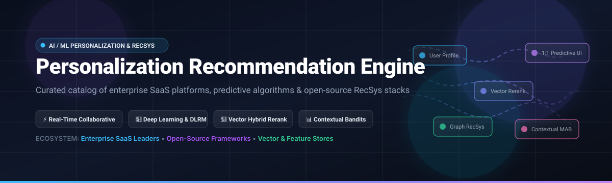
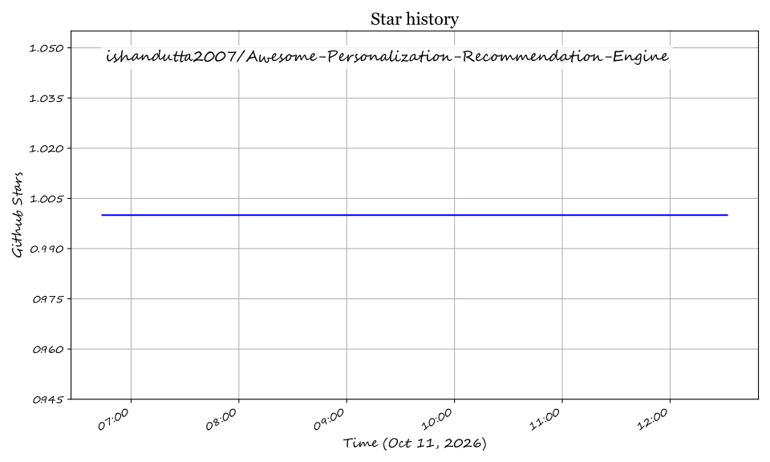

  
  
  
  
  

  

# 🎯 Awesome Personalization Recommendation Engine

> 🚀 **Curated directory of top enterprise SaaS personalization platforms, machine learning recommendation systems (RecSys), contextual bandit algorithms, vector reranking engines, and open-source frameworks.**

Welcome to **Awesome Personalization Recommendation Engine**! This curated guide covers both world-class commercial SaaS platforms (e.g., Salesforce Einstein, AWS Personalize, Dynamic Yield, Coveo, Algolia) and premier open-source recommender frameworks (e.g., Milvus, PyTorch Geometric, Microsoft Recommenders, Vespa, Gorse, Feast). Whether you are building real-time eCommerce product carousels, dynamic content personalization, collaborative filtering pipelines, or vector-powered multi-stage retrieval systems, this index provides comprehensive architectural and pricing insights.

---

## 📑 Table of Contents
- [🏢 Enterprise SaaS & Hosted Platforms](#-enterprise-saas--hosted-platforms)
- [⭐ Open-Source GitHub Projects](#-open-source-github-projects)
- [🏗️ Architectural Blueprint: Building a Modern RecSys Stack](#%EF%B8%8F-architectural-blueprint-building-a-modern-recsys-stack)
- [🤝 How to Contribute](#-how-to-contribute)
- [⚖️ Disclaimer & Licensing](#%EF%B8%8F-disclaimer--licensing)
- [💖 Support](#-support)
- [📈 Star History](#-star-history)

---

## 🏢 Enterprise SaaS & Hosted Platforms

> 📊 **Estimated Market Size & Sector Dynamics**: The global **Personalization Engines & Recommendation Software Market** is estimated at **~$3.18 Billion (2026)** and projected to exceed **$8.45 Billion by 2031 (CAGR of ~21.6%)**. The sector is **moderately fragmented**; while hyper-cloud infrastructure giants (Amazon AWS, Salesforce) capture heavy enterprise volumes, specialized omnichannel and retail-intelligence platforms (Dynamic Yield by Mastercard, Bloomreach, Coveo, Algolia, Nosto) maintain deep differentiation through domain-specific merchandising logic, zero-code predictive workflows, and automated 1:1 cross-channel targeting.

| 🏢 SaaS Platform | 💰 Starting Paid Price | 🆓 Free Tier Limit | 🏢 Company Scale (Valuation / Revenue) | 🎯 Primary Focus & Strengths |
| :--- | :--- | :--- | :--- | :--- |
| **[Amazon Personalize (AWS)](https://aws.amazon.com/personalize/)** | $0.05/GB data ingestion + $0.24/training hour + $0.067/TPS-hour | AWS Free Tier: 20 GB free data storage, 100 training hours, and 16 TPS-hours of real-time recommendations per month for the first 2 months | **~$1.95 Trillion** Market Cap (Amazon) | ML-driven real-time personalization, user segmentation, and reranking powered by Amazon ML infrastructure |
| **[Salesforce Einstein Recommendation Builder](https://www.salesforce.com/products/einstein/)** | $50/user/month (CRM Analytics Plus) / $150/user/month (Salesforce Enterprise) | 30-day free trial on Salesforce Enterprise CRM sandbox with up to 5 Einstein recommendation model builds | **~$280 Billion** Market Cap (Salesforce) | Enterprise 1:1 business-object recommendations, lead matching, customer journey next-best-action logic |
| **[Algolia Recommend](https://www.algolia.com/products/recommendations/)** | $0.60 per 1,000 recommendation requests (Build & Grow plan) | Free forever plan with 10,000 search & recommend requests/month and 10,000 records | **~$2.25 Billion** Valuation | Ultra-low latency API-first product recommendations, "Frequently Bought Together", and alternative item discovery |
| **[Dynamic Yield by Mastercard](https://www.dynamicyield.com/)** | ~$3,500/month (Enterprise tier contract) | 14-day free pilot / sandboxed proof-of-concept trial upon sales evaluation | **Acquired for ~$300 Million** (Mastercard parent: ~$440B Cap) | Omnichannel experimentation, predictive 1:1 web/app personalization, deep-learning algorithm suites |
| **[Coveo Personalization](https://www.coveo.com/en/solutions/recommendations)** | ~$1,500/month (Pro eCommerce tier) | 14-day free trial on Coveo Cloud platform with up to 50,000 test query interactions | **~$750 Million** Market Cap (TSX: CVO) | AI search, hybrid vector relevance, intent-aware catalog recommendations, and enterprise knowledge indexing |
| **[Bloomreach Personalization](https://www.bloomreach.com/en/products/engagement)** | ~$2,000/month (Bloomreach Engagement standard tier) | 14-day sandboxed demo trial with sample catalog ingestion (10,000 events) | **~$2.20 Billion** Valuation | Commerce Experience Cloud combining customer data engine (CDP), merchandising AI, and email/SMS triggers |
| **[Monetate](https://monetate.com/)** | ~$1,200/month (Growth tier) | 14-day guided proof-of-concept trial for qualified merchants | **~$350 Million** Estimated Enterprise Value | Retail A/B testing, multivariate optimization, dynamic feature flags, and individualized catalog merchandising |
| **[Nosto](https://www.nosto.com/)** | ~$1,000/month (Tiered GMV-based starting package) | 14-day free trial with full eCommerce extension integrations (Shopify, Magento, BigCommerce) | **~$250 Million** Valuation | Autonomous commerce experience platform with visual UGC curation, real-time product sorting, and category personalization |
| **[Barilliance](https://www.barilliance.com/)** | ~$250/month (Starter tier for SMB eCommerce) | 30-day free trial with unlimited eCommerce visitor tracking and recommendation widgets | **~$35 Million** Estimated Enterprise Value | Lightweight eCommerce personalization suite: cart abandonment triggers, cross-sell popups, and dynamic email widgets |
| **[Frosmo](https://frosmo.com/)** | €1,000/month (~$1,080/month Standard tier) | 30-day free development sandbox environment with 10,000 test page views | **~$25 Million** Estimated Enterprise Value | JavaScript-driven front-end personalization, automated layout modulation, and real-time contextual recommendation workflows |

---

## ⭐ Open-Source GitHub Projects

Curated open-source recommendation engines, embedding-driven retrieval pipelines, neural collaborative filtering toolkits, and feature stores. Sorted by GitHub_Stars (descending):

1. **[Milvus](https://github.com/milvus-io/milvus)**   
   🚀 **Cloud-native distributed vector database** engineered specifically for massive-scale similarity search and billions-scale neural candidate retrieval in modern two-stage recommender pipelines. *Apache-2.0 Licensed*.

2. **[Qdrant](https://github.com/qdrant/qdrant)**   
   ⚡ **High-performance Rust-based vector search engine & database** offering rich payload filtering and fast ANN retrieval for personalized semantic matching and real-time user-item embeddings. *Apache-2.0 Licensed*.

3. **[PyTorch Geometric (PyG)](https://github.com/pyg-team/pytorch_geometric)**   
   🕸️ **Graph Neural Network (GNN) library for PyTorch** frequently leveraged for cutting-edge relational user-item graph embeddings, link prediction, and social recommendation systems. *MIT Licensed*.

4. **[Microsoft Recommenders](https://github.com/recommenders-team/recommenders)**   
   🏆 **Production-ready utilities, best practices, and model implementations** (SAR, NCF, DKN, LightGCN, xDeepFM) developed by Microsoft for rapid recommender system deployment. *MIT Licensed*.

5. **[DGL (Deep Graph Library)](https://github.com/dmlc/dgl)**   
   🔬 **Framework for deep learning on graphs** providing scalable PinSAGE and RGCN algorithms optimized for multi-billion node industrial recommendation graphs. *Apache-2.0 Licensed*.

6. **[Apache PredictionIO](https://github.com/apache/incubator-predictionio)**   
   📦 **Full-stack open-source machine learning server** built on Apache Spark, HBase, and Spray for creating customizable predictive recommendation microservices. *Apache-2.0 Licensed*.

7. **[Gorse](https://github.com/gorse-io/gorse)**   
   🌟 **End-to-end, batteries-included recommendation system written in Go**, providing automatic collaborative filtering, matrix factorization, click-through rate prediction, and RESTful APIs with an intuitive admin dashboard. *Apache-2.0 Licensed*.

8. **[Feast](https://github.com/feast-dev/feast)**   
   🥩 **Leading open-source feature store for machine learning**, powering low-latency serving of real-time user profiles and historical interaction metrics for recommendation inference. *Apache-2.0 Licensed*.

9. **[Vespa](https://github.com/vespa-engine/vespa)**   
   🏎️ **The open big data serving engine by Yahoo/Vespa Team**, handling joint real-time vector search, multi-phase ranking with neural models (ONNX, PyTorch), and lexical filtering at millisecond latencies. *Apache-2.0 Licensed*.

10. **[Surprise](https://github.com/NicolasHug/Surprise)**   
    ✨ **Simple Python library for building and analyzing recommender systems**, offering classic explicit rating matrix factorization (SVD, SVD++, NMF) and evaluation metrics. *BSD-3-Clause Licensed*.

11. **[LightFM](https://github.com/lyst/lightfm)**   
    💡 **Python implementation of hybrid recommendation algorithms** incorporating both user/item content metadata and implicit interaction feedback using WARP loss. *Apache-2.0 Licensed*.

12. **[RecBole](https://github.com/RUCAIBox/RecBole)**   
    🧪 **Unified, comprehensive, and research-grade PyTorch recommendation library** containing 80+ benchmarked algorithms across sequential, context-aware, knowledge-aware, and social recommendation. *MIT Licensed*.

13. **[DLRM](https://github.com/facebookresearch/dlrm)**   
    🧠 **Meta AI's reference Deep Learning Recommendation Model (DLRM)** for personalized click-through rate (CTR) prediction and embedding table management. *MIT Licensed*.

14. **[Implicit](https://github.com/benfred/implicit)**   
    ⚡ **Fast Python collaborative filtering for implicit feedback datasets**, accelerated with Cython, CUDA C++, and multi-threaded CPU matrix decomposition algorithms (ALS, BPR, Logistic Matrix Factorization). *MIT Licensed*.

15. **[Spotlight](https://github.com/maciejkula/spotlight)**   
    🔦 **Deep learning recommender models in PyTorch**, providing intuitive primitives for implicit feedback, sequential recommenders (LSTM/CNN pooling), and factorization architectures. *MIT Licensed*.

16. **[TorchRec](https://github.com/facebookresearch/TorchRec)**   
    🔥 **Meta's PyTorch domain library for recommendation systems**, providing high-throughput multi-GPU sharding, distributed embedding lookup, and pipeline parallelism. *BSD-3-Clause Licensed*.

17. **[TensorFlow Recommenders (TFRS)](https://github.com/tensorflow/recommenders)**   
    📊 **Google's official library for building recommender system models with TensorFlow**, streamlining candidate generation (two-tower models), scoring, and multi-task ranking. *Apache-2.0 Licensed*.

18. **[NVIDIA Merlin](https://github.com/NVIDIA-Merlin/Merlin)**   
    🎮 **NVIDIA's open GPU-accelerated recommendation framework** covering end-to-end feature engineering (NVTabular), training, and ultra-low latency Triton inference serving. *Apache-2.0 Licensed*.

19. **[LensKit](https://github.com/lenskit/lenskit)**   
    🔍 **Open-source Python toolkit for experimental recommender systems research and education**, featuring rigorous benchmarking pipelines and modular evaluators. *MIT Licensed*.

20. **[GER (Good Enough Recommender)](https://github.com/grahamjenson/ger)**   
    ☕ **Lightweight, embeddable recommendation engine written in Node.js and PostgreSQL/Redis**, ideal for microservices needing event-driven collaborative filtering without deep ML clusters. *MIT Licensed*.

---

## 🏗️ Architectural Blueprint: Building a Modern RecSys Stack

When architecting a production-scale 1:1 personalization solution:
- 📥 **Event Ingestion & Tracking**: Capture clickstreams, impressions, and transactions in real time with Kafka, Snowplow, or Segment.
- 🥩 **Feature Store & Online Profiles**: Store real-time context and customer affinity histories using **Feast**.
- 🔍 **Candidate Generation (Retrieval Stage)**: Narrow catalog down from 10M+ items to top 1,000 using approximate nearest neighbors (ANN) via **Milvus**, **Qdrant**, or **Vespa**.
- 🧠 **Heavy Reranking & CTR Prediction**: Score candidates with multi-task deep neural networks using **TensorFlow Recommenders (TFRS)**, **TorchRec**, **DLRM**, or **NVIDIA Merlin**.
- 🧪 **Online Exploration & Bandits**: Apply Contextual Multi-Armed Bandits (MAB) or Thompson Sampling to balance exploitation of familiar preferences with new item discovery.
- 🏢 **Turnkey Enterprise Layer**: When development speed and turnkey business UI are paramount, integrate **AWS Personalize**, **Algolia Recommend**, or **Dynamic Yield**.

---

## 🤝 How to Contribute

1. 🍴 Fork the repository.
2. 📝 Add or edit entries in `README.md` maintaining the table/list structure and social Stars_Badges.
3. 📌 Ensure entries include official links, factual descriptions, pricing/licensing context, and verified repositories.
4. 🚀 Submit a Pull Request with a clear description of your contribution.

---

## ⚖️ Disclaimer & Licensing

- 💡 This repository is a **community-curated index** published for informational, architectural, and educational purposes.
- 🔐 All product names, logos, and brands are property of their respective owners. Mentioning SaaS vendors and open-source projects does not imply direct commercial endorsement.

---

## 💖 Support

Thank you for exploring **Awesome Personalization Recommendation Engine**! If you find this curated ecosystem index helpful, please consider supporting the project:

- ⭐ **Star** this repository on GitHub to show your appreciation.
- 🔀 **Fork** and contribute new recommendation algorithms, enterprise engines, or architectural tools.
- 📢 **Share** it with fellow machine learning engineers, data scientists, and growth architects.
- ☕ **Sponsor**: Buy me a coffee or support ongoing maintenance via the [GitHub Sponsor Dashboard](https://github.com/sponsors/ishandutta2007).

---

## 📈 Star History

---

  <b>Built for AI/ML engineers, data scientists, and personalization architects.</b> 
  <i>Let's build accurate, ethical, and scalable recommendation engines.</i>

## Star History

<a href="https://star-history.com/#ishandutta2007/Awesome-Personalization-Recommendation-Engine&Timeline" align="center">
  <picture>
    <source media="(prefers-color-scheme: dark)" srcset="assets/ishandutta2007_Awesome-Personalization-Recommendation-Engine_growth.svg">
    
  </picture>
</a>
